# Mini-Cyberdeck

A neon, keyboard-driven terminal command deck for a Raspberry Pi: a live
Noctua fan tachometer on GPIO2, system dashboards, a recon & reference
console, a USB serial terminal, and a pile of tools — all in one TUI that
runs on anything from a 40×12 window to a full-screen monitor. On screen it
boots up as **CYBERDECK**.

Repo: <https://github.com/notthepotato/Mini-Cyberdeck>

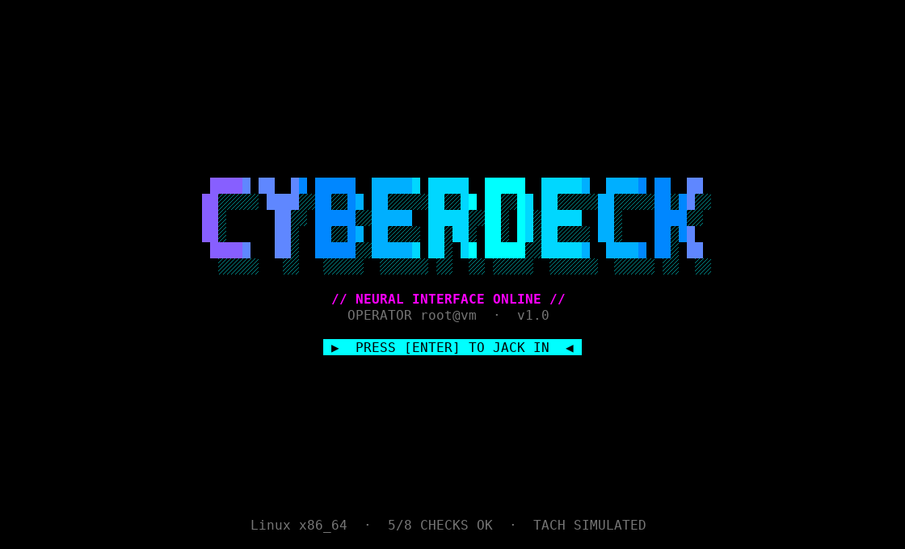

## Screenshots

| Dashboard | Fan tachometer |
|---|---|
| 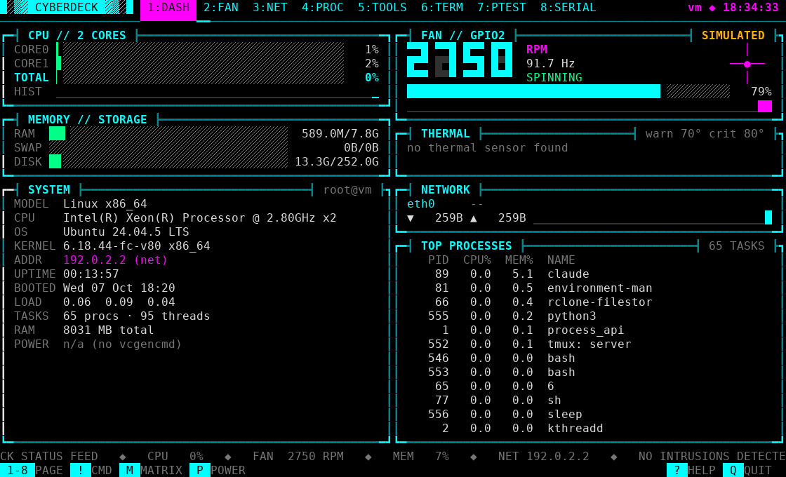 | 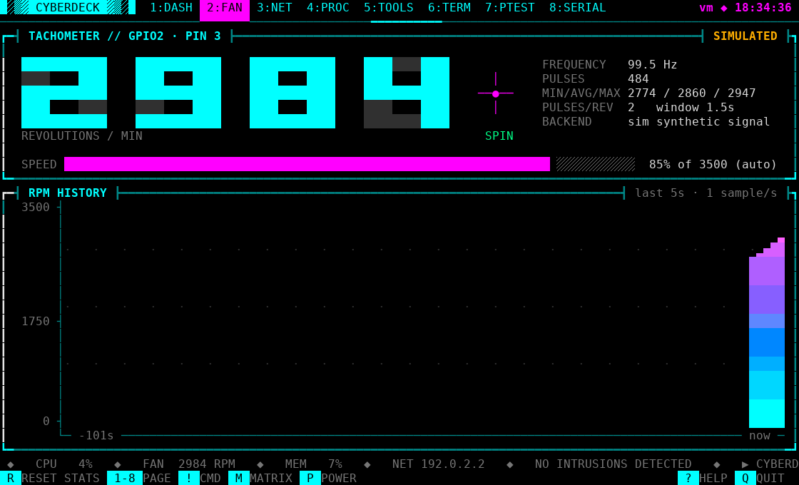 |

| Pen-test · LAN recon | Pen-test · wireless survey |
|---|---|
| 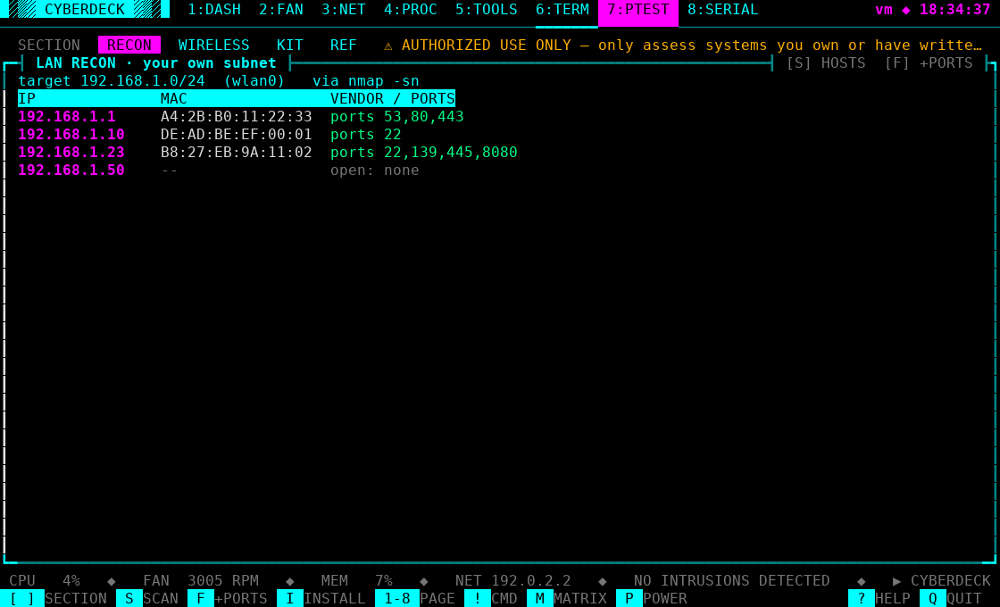 | 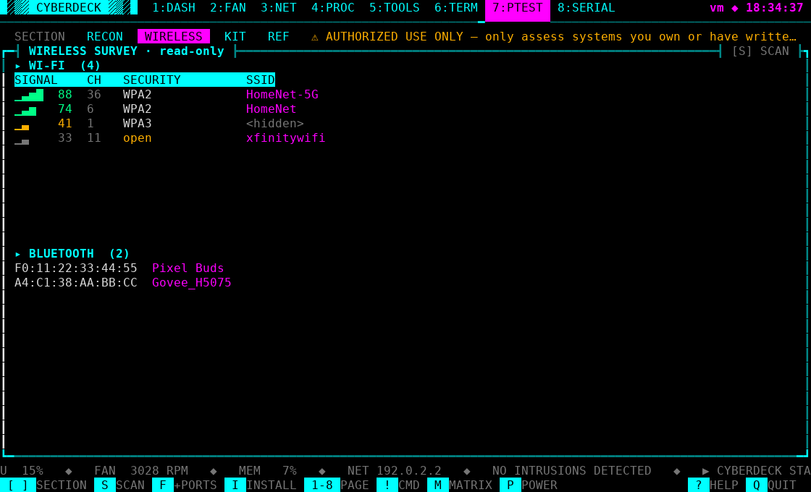 |

| Pen-test · kit inventory | Serial console |
|---|---|
| 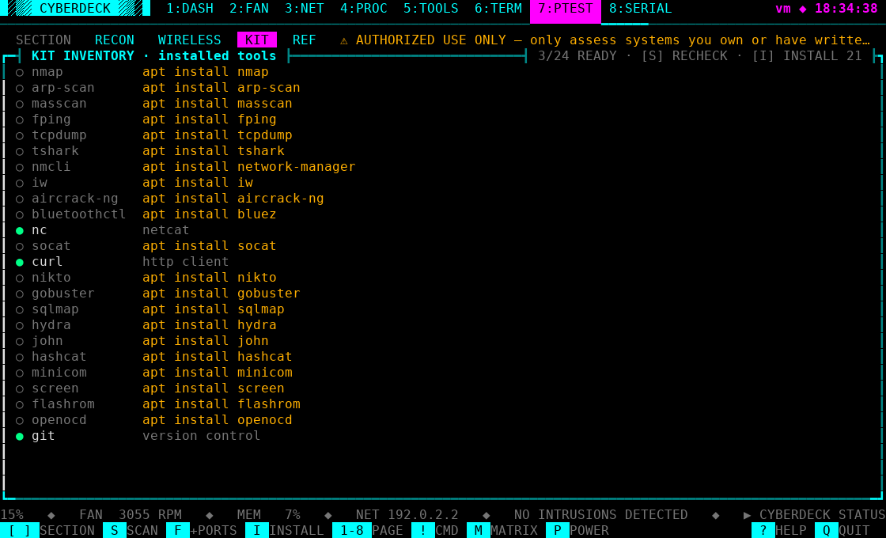 | 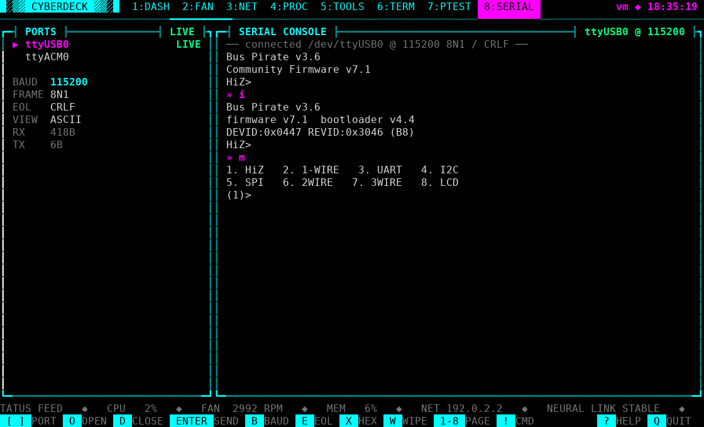 |

| Tools (stopwatch · timer · notes · keygen) | |
|---|---|
|  | |

## Pictures 

|---|---|
| 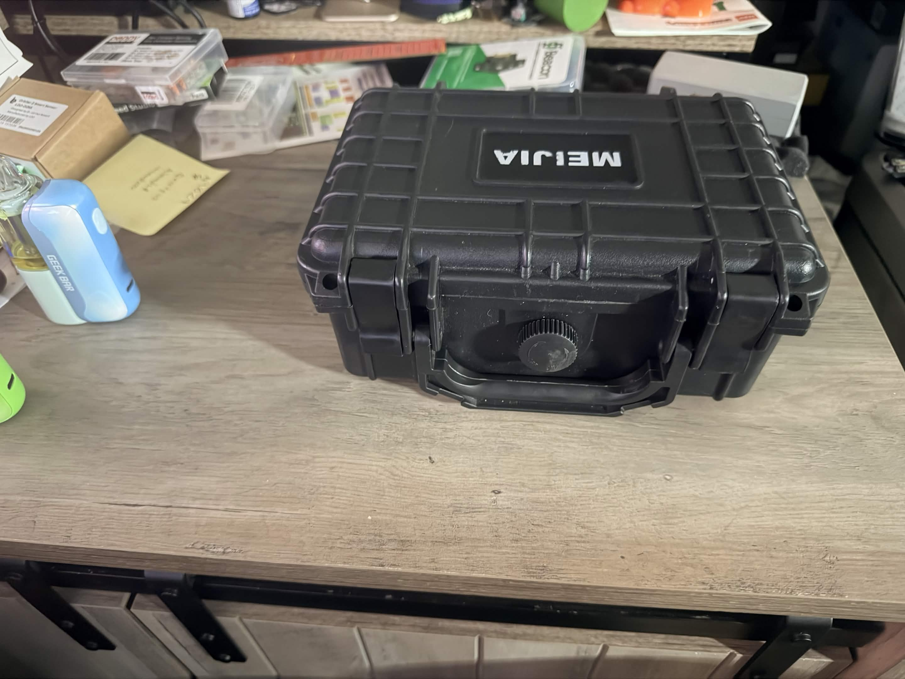 | 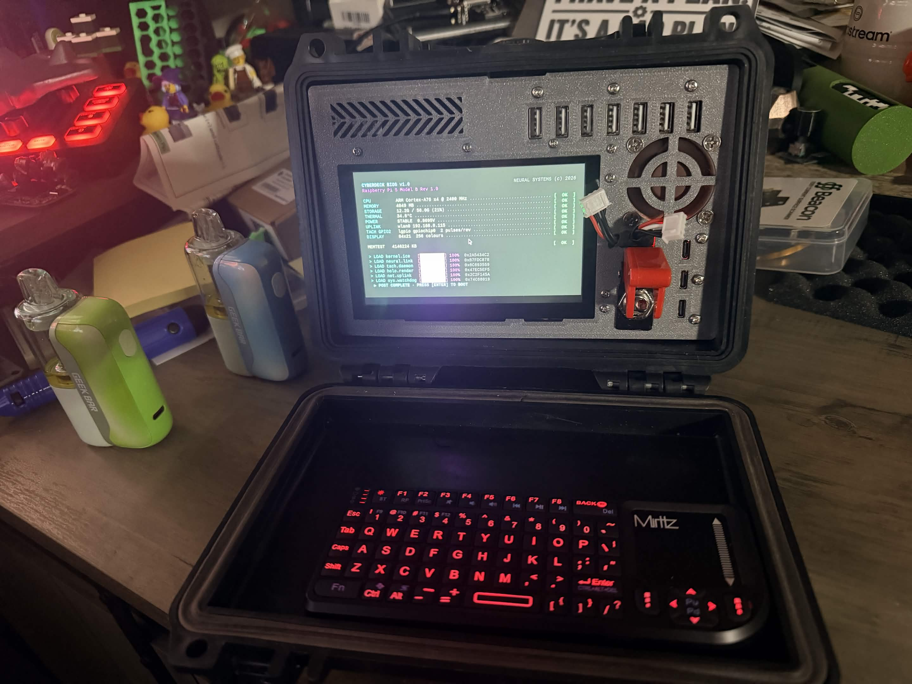 |
|---|---|
| 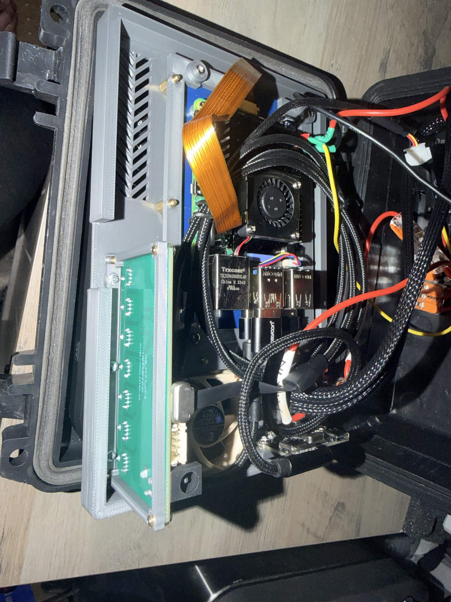 | 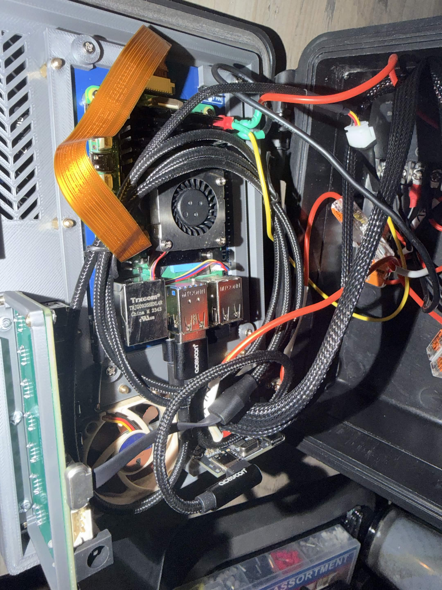 |
|---|---|
| 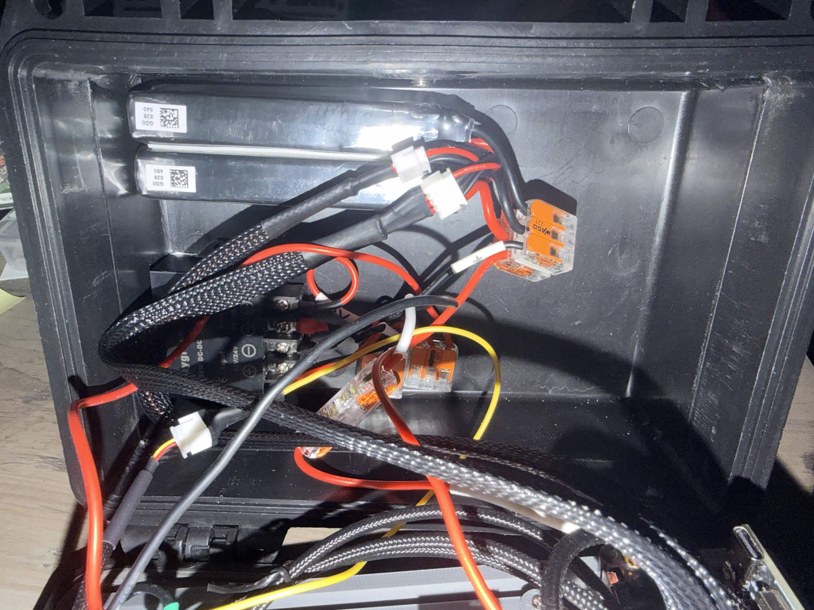 | |

## Bill of materials (BOM)

The parts in this build. **Fill in the Price column with what you paid** — the
links are the exact items used. Quantities and part names are easy to edit.

### Core build

| # | Component | Part / model | Qty | Price | Link |
|---|-----------|--------------|-----|-------|------|
| 1 | Single-board computer | Raspberry Pi 5 | 1 |  | — |
| 2 | microSD card | 32 GB+ A2, Raspberry Pi OS 64-bit | 1 |  | — |
| 3 | Display | Hosyond 5" IPS DSI touchscreen, 800×480 (driver-free) | 1 |  | [Amazon](https://www.amazon.com/dp/B0CXTFN8K9) |
| 4 | Cooling fan | Noctua NF-A4x10 5V, 40 mm, 3-pin (with tach) | 1 |  | [Amazon](https://www.amazon.com/dp/B00NEMGCIA) |
| 5 | Keyboard | K808 mini Bluetooth keyboard + touchpad, backlit | 1 |  | [Amazon](https://www.amazon.com/dp/B0797Q97FK) |
| 6 | Power switch | Nilight 90014E rocker toggle, 12 V 20 A (5-pack) | 1 |  | [Amazon](https://www.amazon.com/dp/B07QKFD7Z7) |
| 7 | Case | MEIJIA IP67 waterproof hard case, 8.12×6.56×3.56 in, foam insert | 1 |  | [Amazon](https://www.amazon.com/dp/B07S1K184L) |

### Power — battery → buck → GPIO pins

The Pi is powered through its **5 V GPIO pins**, not the USB-C port.

| # | Component | Part / model | Qty | Price | Link |
|---|-----------|--------------|-----|-------|------|
| 8 | Battery | 12 V cell | 2 |  | — |
| 9 | Buck converter | step-down to 5 V (size for a Pi 5, ~5 A) | 1 |  | — |

### USB & cables

| # | Component | Part / model | Qty | Price | Link |
|---|-----------|--------------|-----|-------|------|
| 10 | USB-C PD cable | DbillionDa 90°, 60 W, 3.3 ft | 1 |  | [Amazon](https://www.amazon.com/dp/B0CCJLS4R5) |
| 11 | USB-C short cable | aceyoon 90°, 0.6 ft (3-pack) | 1 |  | [Amazon](https://www.amazon.com/dp/B096VYVR17) |
| 12 | USB hub board | xiwai USB-C 1→3 ports PCBA | 1 |  | [Amazon](https://www.amazon.com/dp/B0F2MK23DW) |
| 13 | USB hub board | xiwai USB-C / 4-pin 1→7 ports PCBA | 1 |  | [Amazon](https://www.amazon.com/dp/B0F2MM5F53) |

### Fan tach circuit

| # | Component | Part / model | Qty | Price | Link |
|---|-----------|--------------|-----|-------|------|
| 14 | Resistor | 100 kΩ — tach pull-up to 3V3 | 1 |  | — |
| 15 | Jumper wires | female–female Dupont | few |  | — |

### Fasteners & enclosure hardware

| # | Component | Part / model | Qty | Price | Link |
|---|-----------|--------------|-----|-------|------|
| 16 | Screws | M3 | — |  | assorted lengths |
| 17 | Heat-set inserts | M3 | — |  | brass, for 3D prints |
| 18 | Screws | M2.5 | — |  | assorted lengths |
| 19 | Heat-set inserts | M2.5 | — |  | brass, for 3D prints |
| 20 | 3D-printed parts | mounting plates / bezel / internal frame | 1 set |  | fit inside the hard case |

**Plug-in devices (optional, not part of the deck):** the SERIAL tab talks to a
Bus Pirate, M5Stack Cardputer, Arduino/ESP32 or any USB-UART adapter; the PTEST
field kit can use a monitor-mode USB Wi-Fi adapter, a USB-Ethernet adapter, a
logic analyzer or an RTL-SDR.

<!-- Add rows as you buy parts; fill in the Price column and a running total. -->

## Run it

On the Pi this lives in `~/Documents/UI`; a fresh clone works too:

    git clone https://github.com/notthepotato/Mini-Cyberdeck.git
    cd Mini-Cyberdeck
    python3 cyberdeck.py

Open a terminal and run:

    cd ~/Documents/UI
    python3 cyberdeck.py

Other ways to run it:

    python3 cyberdeck.py --sim        # fake fan signal, to preview without hardware
    python3 cyberdeck.py --no-boot    # skip the startup animation and title screen
    python3 cyberdeck.py --help       # all options

Startup has two stops, and each waits for you to press **Enter**:

1. **Hardware check:** the BIOS-style list of checks ends with
   `PRESS [ENTER] TO BOOT`.
2. **Title screen:** the CYBERDECK logo shows `PRESS [ENTER] TO JACK IN`.

Pressing Enter while either animation is still playing jumps to that stage's
prompt, so you never skip a stage by accident. **Q** at either prompt exits.

Any terminal size works, from a small 40x12 screen up to a full-screen
monitor. The logo, the RPM readout and the timers grow with the window. On
small screens, panels shrink or drop out in order of importance. You can
resize the window while it's running.

## Boot straight into CYBERDECK (no desktop)

Run this once in a terminal on the Pi (it needs internet and asks for your password):

    bash ~/Documents/UI/install-autostart.sh

After a reboot, the Pi skips the desktop and opens CYBERDECK across the whole
screen, with no taskbar or window borders.

* **Q** quits to a text prompt. Type `cyberdeck` to start it again,
  `desktop` to open the normal desktop, or `sudo reboot`.
* **Text size:** change `FONT_SIZE` near the top of `launch-cyberdeck.sh`
  (default 11; bigger number = bigger text, fewer columns).
* **SSH** logins are left alone and get a normal shell.
* **Undo:** `bash ~/Documents/UI/uninstall-autostart.sh` boots to the desktop again.

### Small screens & text cut off at the edges (e.g. a 5" 800×480 panel)

Some small panels don't show the very outer edge of the picture, so the header
and footer can run off-screen even though the app is drawing them. The kiosk
launcher leaves a 2-cell safe border by default. If text is still cut off at the
edges, increase it:

    CYBERDECK_MARGIN=4 cyberdeck        # bigger safe border, try 3–6

Set it permanently by changing `MARGIN` near the top of `launch-cyberdeck.sh`,
or run it by hand with `python3 cyberdeck.py --margin 3`.

On an **HDMI** display this is usually overscan, which you can instead turn off
in `sudo raspi-config` → Display Options (or `disable_overscan=1` in
`/boot/firmware/config.txt`), then set `CYBERDECK_MARGIN=0`. The 5" **DSI**
panel in this build is driver-free and pixel-exact, so the margin is the fix
there.

How it works: the Pi boots to the text console and logs in automatically.
Your login profile then starts `launch-cyberdeck.sh`, which runs CYBERDECK
inside *cage* (a one-app full-screen kiosk) and *foot* (a terminal), so you
get full colours and fonts without the desktop. If those two programs aren't
installed, it runs on the plain text console instead, with fewer colours.

The Claude desktop app only runs inside the desktop. While you're in
CYBERDECK mode, type `desktop` first if you want Claude to work with your Pi.

## Wiring & power

### Power (through the GPIO pins)

This build runs the Pi from a battery, not the USB-C port:

    2 × 12 V cells  →  buck converter (set to 5 V)  →  Pi 5 V pins (2 or 4) + GND

A rocker switch breaks the battery line, and the 5 V Noctua fan runs off the
same 5 V rail. Feeding 5 V straight into the GPIO header skips the Pi's own
input protection, so set the buck to a clean 5.0–5.1 V **before** connecting it,
and make sure it can supply the Pi's draw (a Pi 5 can pull up to ~5 A).

### Fan tachometer (Noctua, 3-pin)

| Fan wire        | Goes to                        |
|-----------------|--------------------------------|
| Green (tach)    | GPIO2 = physical pin 3         |
| Black (ground)  | any GND, e.g. physical pin 6   |
| Yellow (+5 V)   | the 5 V rail (pin 2 or 4)      |

* The tach line is pulled up to 3V3 — this build uses a **100 kΩ** resistor.
  GPIO2 also has a ~1.8 kΩ pull-up on the Pi itself, so it's held high either
  way, and never sees more than 3.3 V.
* GPIO2 is also the I2C data pin. Keep I2C **off**
  (`sudo raspi-config` → Interface Options → I2C → No), or the pin will be busy.
* Noctua fans give 2 pulses per revolution (the default `--ppr 2`).
* If the RPM reads high or jumps around, add `--debounce 100`.

## Pages

| Key | Page  | What's on it |
|-----|-------|--------------|
| 1   | DASH  | CPU cores, memory/disk, system info, fan, temperature, network, top processes |
| 2   | FAN   | Big RPM readout, spinning rotor, min/avg/max, pulse count, speed gauge, RPM history graph |
| 3   | NET   | Interfaces and IPs, Wi-Fi signal, RX/TX graphs, **D** = gateway/uplink/DNS diagnostics |
| 4   | PROC  | Full process table, **S** switches between CPU and memory sort |
| 5   | TOOLS | Stopwatch with laps, countdown timer, notes (saved to `deck_notes.txt`), password/PIN/UUID generator |
| 6   | TERM  | Run shell commands with **!**, plus an event log of alerts and actions |
| 7   | PTEST | Recon & reference console for your own systems (see below) |
| 8   | SERIAL| Serial terminal for USB devices like a Bus Pirate or Cardputer (see below) |

Global keys: **Tab** or the arrows switch pages, **M** starts the matrix screensaver,
**P** opens the power menu (reboot/shutdown), **?** shows help, **Q** quits.
You can also click or tap the page tabs.

## PTEST — recon & reference (page 7)

A reconnaissance and reference console for **your own** systems. It runs standard
tools you already have installed and inventories them; it contains no attack or
exploit code, and network scans only touch the private subnet this device is on.
Switch sections with **[** and **]**; press **S** to scan/refresh the active one.

* **RECON** — **S** discovers live hosts on your own subnet (uses `nmap` or
  `arp-scan` if installed, otherwise a built-in ping sweep). **F** also scans
  common TCP ports on each host found. Shows IP, MAC, vendor and open ports.
* **WIRELESS** — **S** lists nearby Wi-Fi access points (SSID, signal, channel,
  security) via `nmcli`, and nearby Bluetooth devices via `bluetoothctl`.
  Read-only; it just observes.
* **KIT** — checks which common recon/audit/serial tools are installed, with an
  `apt install` hint for the missing ones. A quick "is my kit ready" view.
  Press **I** to install every missing tool at once; it asks you to press **I**
  again to confirm, then streams apt's output live in the panel.
* **REF** — pentest methodology phases and a physical field-kit packing list.

Scanning tools aren't required — install what you want. The **I** key in the KIT
section installs all the missing ones for you, or run it yourself, e.g.
`sudo apt install nmap arp-scan network-manager bluez`. The RECON ping-sweep
fallback works with no extra tools.

The in-app installer needs passwordless `sudo` (the default for the first user
on Raspberry Pi OS). If it isn't set up, the panel prints the exact
`sudo apt install …` line to paste into a terminal instead.

## SERIAL — USB serial console (page 8)

A dependency-free terminal for talking to a Bus Pirate, M5Stack Cardputer,
Arduino, ESP32, FTDI cable — anything that shows up as USB serial. It auto-lists
`/dev/ttyUSB*`, `/dev/ttyACM*` and the Pi's own UART, and defaults to **115200 8N1**
(the Bus Pirate default; change with `--baud`).

| Key | Does |
|-----|------|
| **[** / **]** | select a port |
| **O** | open (connect to) the selected port |
| **D** | disconnect |
| **Enter** | type a line and send it to the device (Enter sends, Esc leaves) |
| **B** | cycle baud rate (reconnects live) |
| **E** | cycle line ending sent with each line (CRLF / CR / LF / none) |
| **X** | toggle hex / ASCII view of incoming bytes |
| **W** | wipe the scrollback · **R** rescan ports · **↑↓/PgUp/PgDn** scroll |

If a port says *permission denied*, add yourself to the serial group once:
`sudo usermod -aG dialout $USER`, then log out and back in.

A red alert bar flashes if the fan stalls (no pulses for 3 seconds),
the CPU passes 80°C, or the Pi reports under-voltage.

## Useful options

    --max-rpm 5000     fix the gauge's full scale (default: auto)
    --debounce 100     filter electrical noise if RPM reads too high
    --saver 10         matrix screensaver after 10 idle minutes
    --pin 18           tach on a different GPIO
    --baud 115200      default baud for the SERIAL tab
    --margin 3         inset the UI by N cells (for displays that crop the edge)
    --no-mouse         keep normal text selection in the terminal

## Troubleshooting

* **FAN page says OFFLINE / GPIO busy**: I2C is probably on (see above).
* **No module named lgpio**: `sudo apt install python3-lgpio`
* **RPM jumps around or reads double**: try `--debounce 100`.
* **Boxes look like question marks**: your terminal font lacks the
  block characters. The default Raspberry Pi OS terminal is fine.
* **Text cut off at the edges**: the panel isn't showing the outer edge — raise
  `CYBERDECK_MARGIN` (see "Small screens" above).
* **Power menu (P) does nothing**: it needs permission to reboot/shut down.
  It tries `systemctl` then `sudo`; if both are blocked it shows the error in
  the menu. Run `sudo systemctl reboot` from the TERM tab to confirm it works,
  or enable passwordless sudo for the first user.
* **"Install all" in KIT sits on "working"**: apt can be slow or waiting on the
  package lock; press **I** again to cancel. It also gives up after 30 minutes.
